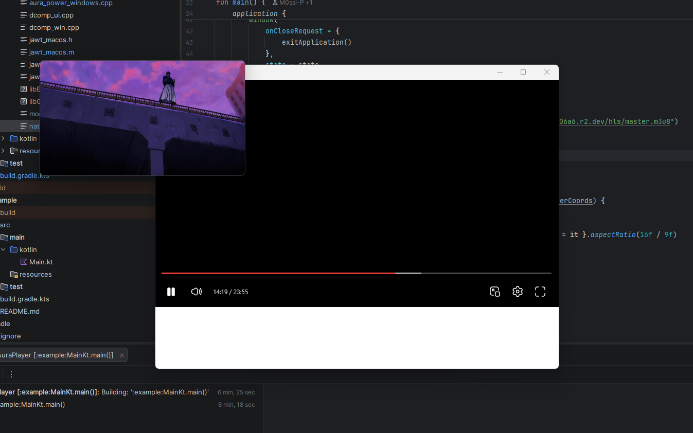
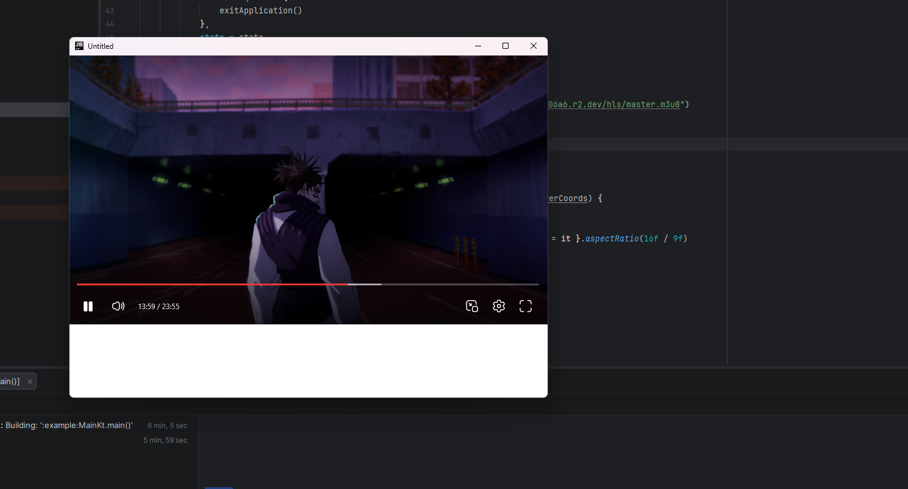
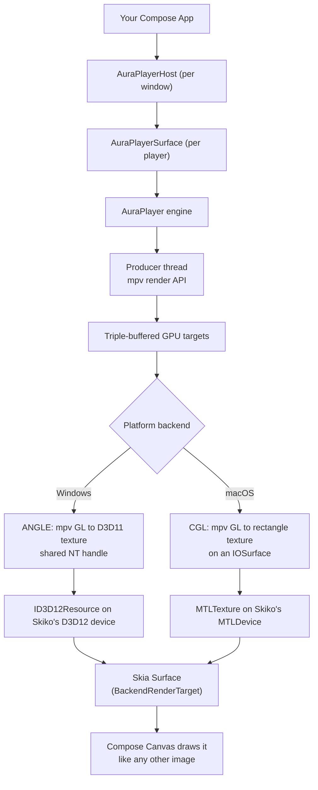

# AuraPlayer

**AuraPlayer** is a high-performance **cross-platform desktop media playback engine written in Kotlin**.

mpv decodes and renders on the GPU; the finished frame is handed to Skia as a texture and drawn as a
**real Compose element**. No native child window, no compositor overlay, no frame ever touching the
JVM heap.

AuraPlayer supports **both audio and video playback** and is designed to be embedded into JVM desktop
applications while maintaining hardware-accelerated performance.

The project exists to fill a gap in the JVM ecosystem: there was no modern desktop media engine
comparable in capability to players like ExoPlayer that still integrated cleanly with desktop UI
frameworks.

---

## Screenshots

| Player with controls                                          | Settings popover                                                |
|---------------------------------------------------------------|-----------------------------------------------------------------|
|  |  |

---

## What makes it different

Most JVM video solutions paint frames into an AWT component, which forces a choice: either the video
is on top and nothing can overlay it, or you pay to copy every frame back through the JVM.

AuraPlayer does neither. mpv renders into a GPU texture that is **shared with Skia's own device** —
the same device Compose already draws with. Compose then draws that texture like any other image.

The consequence is that video stops being a special case:

- **Z-order is just declaration order.** Anything can be drawn above or below the video — controls,
  dialogs, blur, rounded corners, scrims. No alpha-blending tricks, no layer arbitration.
- **Clipping, transforms and scrolling work.** The video is inside Compose's layout, so
  `clip`, `graphicsLayer`, scrollables and `AnimatedVisibility` all behave normally.
- **Any nesting depth, any number of players.** No per-window surface budget, no "primary player"
  that gets the fast path while others degrade.
- **Multiple windows share one decode.** A picture-in-picture window wraps the *same* buffers the
  main window is reading — one mpv instance, one decode, two views.

Also:

- Hardware-accelerated decoding
- Zero-copy GPU pipeline (no CPU readback, no `glReadPixels`, no bitmap round-trip)
- Playback continues during window drag and resize
- Audio-only playback supported
- Most common containers and codecs *(depending on native backend support)*

---

## Modules

| Module | Purpose |
|---|---|
| **`auraplayer-core`** | The playback engine — media pipeline, JNI bridge, native rendering, decoding. No UI framework dependency. |
| **`auraplayer-compose`** | Compose Desktop integration — video surface composable, player controls, fullscreen and picture-in-picture. Includes core. |

**Getting started, installation and usage live in the module docs:**
→ [`auraplayer-compose/README.md`](auraplayer-compose/README.md)

---

## Architecture

The pipeline is the same shape on both platforms; only the sharing primitive differs.



### The shared-texture bridge

Skiko already owns a GPU device to render Compose with — D3D12 on Windows, Metal on macOS.
AuraPlayer reaches that device, imports mpv's output texture into it, and wraps the result as a Skia
`Surface`. From that point Compose is drawing a texture it considers its own.

**Windows.** mpv renders OpenGL through **ANGLE** into an EGL pbuffer backed by a D3D11 texture,
created with `D3D11_RESOURCE_MISC_SHARED_NTHANDLE`. The handle is opened on Skiko's D3D12 device
via `OpenSharedHandle`, wrapped with `BackendRenderTarget.makeDirect3D`, and turned into a
`Surface`.

**macOS.** mpv renders through **CGL** (desktop OpenGL 4.1) into a `GL_TEXTURE_RECTANGLE` bound to an
**IOSurface** via `CGLTexImageIOSurface2D`. The same IOSurface is imported on Skiko's `MTLDevice`
with `newTextureWithDescriptor:iosurface:plane:`, wrapped with `BackendRenderTarget.makeMetal`, and
turned into a `Surface`.

IOSurface is the macOS analogue of Windows' shared NT handle: a GPU allocation two devices can both
address without a copy.

### The producer thread

mpv does **not** render on Compose's draw pass. A dedicated producer thread owns the GL context and
renders whenever mpv signals a new frame (`mpv_render_context_set_update_callback`).

This matters because Compose stops executing draw lambdas during a live window resize — it replays a
recorded picture instead. A player driven by the draw pass freezes while you drag the window. The
producer keeps decoding and publishing regardless of what the UI thread is doing.

**Triple buffering** keeps the two sides apart. Two buffers tear; with three, the producer always has
a target that is neither the published frame nor the one currently being drawn:

```
front   ← newest complete frame, published
inuse   ← what the consumer is drawing right now
back    ← neither of the above; the producer writes here
```

The consumer calls `acquireFront()`, which publishes its index as `inuse` and returns it. Resizes are
handled between frames without restarting the producer, so a quality switch or window resize doesn't
interrupt playback.

### Rendering flow

```
mpv decode + render  (producer thread)
        ↓
GPU texture  (D3D11 texture / IOSurface)
        ↓
imported on Skiko's device  (D3D12 resource / MTLTexture)
        ↓
Skia Surface
        ↓
Compose Canvas  →  drawn in normal z-order
```

### Fullscreen and picture-in-picture

Because the video is an ordinary composable, **fullscreen is a layout change**: the player is lifted
into an overlay `Box` at the window root. No native geometry work, no surface re-creation, no
flicker.

**Picture-in-picture** opens a second always-on-top window that wires its own Skia surfaces to the
same producer buffers — one decode, two views. The window keeps its OS shadow, snap behaviour and
resize borders while hiding the title bar (`WM_NCCALCSIZE` on Windows, `NSWindowStyleMaskFullSizeContentView`
on macOS), and locks its aspect ratio to the video's display dimensions.

---

## Requirements

| | Minimum |
|---|---|
| JDK | 21 (JetBrains Runtime recommended) |
| Kotlin | 2.2.20 |
| Compose Multiplatform | 1.10.0-rc01 |
| OS | Windows 10 1809+ / macOS 11+ |

Windows additionally requires a Direct3D 11 capable GPU (feature level 11_0).

Native libraries — `libmpv-2.dll`, `libEGL.dll`, `libGLESv2.dll` on Windows; `libmpv.dylib` on
macOS — are bundled in the jar and extracted at first launch. mpv does not need to be installed
separately.

---

## Current limitations

- **SDR only.** HDR content plays (tone-mapped), but output is 8-bit. Skiko's swapchain format is
  fixed, and widening it would put the entire Compose UI in an HDR colorspace.
- Each player currently creates its own GPU device and GL context; sharing one across players is a
  pending optimization.
- Debug tracing is compiled in but silent — set `AURA_DEBUG=1` to enable it.

---

## Troubleshooting

**Video is black but audio plays.** Skia caches a snapshot keyed to its own writes, so an externally
written texture looks unchanged. `notifyContentWillChange(ContentChangeMode.RETAIN)` before every
draw is what invalidates it. The signature symptom is black until a fullscreen toggle, then a single
frozen frame.

**Video is upside down.** GL renders bottom-up, Metal and Skia read top-down. Apply exactly one flip
— either `MPV_RENDER_PARAM_FLIP_Y` or `SurfaceOrigin.BOTTOM_LEFT` — never both.

---

## License

<!-- TODO -->